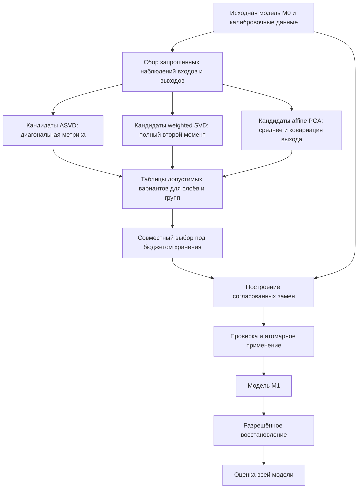

# Предложение: типизированный граф процесса сжатия FedCore

Дата: 19.10.2026. Архитектура утверждена для [PR #140](https://github.com/v1docq/FedCore/pull/140). Этот документ описывает целевое устройство и этапы; фактические возможности и ограничения приведены в отчётах [G0–G1](IMPLEMENTATION_GRAPH_G1.md), [G2a](IMPLEMENTATION_GRAPH_G2A.md) и [G2b](IMPLEMENTATION_GRAPH_G2B.md), задачи — в [плане внедрения](COMPRESSION_GRAPH_ISSUES.md).

Проверенная версия PR: `424947e74c760a52e8a290ade451027d9c970aff`, ветка `svd_compression`, основание `fedcore_refactoring`. Внешняя проверка GitHub и локальная версия совпали.

## Решение

Общие шаги методов следует представить явными операциями процесса сжатия. Эволюционный поиск должен изменять осмысленные решения внутри этих операций и разрешённые композиции, пользуясь типизированной грамматикой.

Предлагаемая граница узла — **самостоятельная математическая или структурная задача с проверяемым контрактом**, а не отдельное арифметическое действие и не обязательно название статьи. Крупные операции SVD, pruning и quantization остаются доступными как составные узлы с раскрываемым внутренним планом.

Нужно различать три объекта:

1. **Граф исполнения нейросети.** Linear, Conv, attention, остаточные ветви, параметры и их физическое хранение.
2. **Граф процесса сжатия.** Сбор наблюдений, построение статистик и метрик, подготовка вариантов, распределение бюджета, создание и применение замен, восстановление и оценка.
3. **Генотип поиска.** Разрешённые решения, из которых компилятор строит граф процесса сжатия. В генотип не обязаны входить все технические вершины этого графа.

На первом этапе генотип задаётся небольшим набором проверенных шаблонов и условных параметров. Затем добавляются преобразования совместимых подграфов. Произвольное соединение всех зарегистрированных функций не входит в начальную архитектуру.

## 1. Что уже реализовано в PR

| Компонент | Проверенное поведение | Следующий архитектурный шаг |
| --- | --- | --- |
| [model_repository.py:10](../../fedcore/repository/model_repository.py#L10) | Внешняя операция `low_rank_model` использует `LowRankModel` | Сохранить внешний вход, раскрывать внутренний план через него |
| [low_rank_opt.py:272](../../fedcore/algorithm/low_rank/low_rank_opt.py#L272) | Явные `compress_weighted`, `compress_profile`, `build_architecture` | Адаптировать существующие запросы к новому плану без изменения смысла API |
| [plans.py:102](../../fedcore/algorithm/low_rank/plans.py#L102) | Неизменяемые запросы, шаги и планы без живых ресурсов | Добавить связи производителей и потребителей артефактов; существующий список шагов ещё не является таким DAG |
| [statistics.py:16](../../fedcore/algorithm/low_rank/statistics.py#L16) | Различаемые статистики, паспорт происхождения, проверка актуальности | Сделать их смысловыми портами графа |
| [approximation.py:86](../../fedcore/algorithm/low_rank/approximation.py#L86) | Взвешенное решение с явными ridge, поддержкой и политикой ядра | Использовать как проверенное численное ядро |
| [allocation.py:80](../../fedcore/algorithm/low_rank/allocation.py#L80) | Уникальная стоимость хранилищ и конечные варианты под бюджетом | Выделить общий узел выбора структуры для независимых слоёв и связанных групп |
| [topology.py:98](../../fedcore/algorithm/low_rank/topology.py#L98) | Проверка набора замен до присваиваний; учёт псевдонимов, вложенности и циклов | Дополнить контрактом базовой версии, чтений, записей и координат |
| [optimisation.py:68](../../fedcore/repository/fedcore_impl/optimisation.py#L68) | Обмен узла через фабрику существующего графового поиска | Подключать подробные узлы после появления семантических контрактов |

Наличие типов ещё не обеспечивает полноту смысловой проверки. Например, `solve_weighted` принимает также обычную матрицу Tensor. Компилятор процесса должен требовать конкретный тип статистики, даже когда численное ядро допускает более низкоуровневый вызов.

Важное различие исполнителей:

- [execution.py:277](../../fedcore/algorithm/low_rank/execution.py#L277) собирает статистики на одной неизменённой копии и устанавливает подготовленные замены в конце;
- [method_execution.py:457](../../fedcore/algorithm/low_rank/method_execution.py#L457) собирает входы на актуальной частично изменённой модели и применяет замену после каждого слоя.

Новый граф должен сохранять оба режима явно.

## 2. Что действительно общее в статьях

Основание — локальные обзоры из папки `01 SVD и проекции`, их сопоставление с текущими реализациями и выборочная проверка первоисточников.

| Семейство | Общая операция | Обязательная особенность |
| --- | --- | --- |
| ASVD | Статистика входа → диагональная метрика → низкоранговое приближение | Средний модуль, показатель alpha и обработка нулевых каналов; метрика не равна полной ковариации |
| FWSVD | Оценка важности → взвешенное приближение | Индивидуальные квадраты градиентов, заданные loss и labels; это другой источник статистики |
| SVD-LLM / DRONE | Полный второй момент или поддержка входов → приближение → локальная реконструкция | Источник текущих входов, топологический порядок и конкретная цель восстановления |
| AFM | Центрированная статистика выхода → проекция признаков | Совместная корректировка весов и смещения |
| EoRA | Остаток двух версий оператора → низкоранговая поправка | Неизменяемая сжатая основа и отдельная остаточная ветвь |
| Basis Sharing | Группировка → общая статистика → совместное приближение | Физически общий базис; единица решения — вся группа |
| FLAT / MoDeGPT / SliceGPT | Статистика → выбор подпространства → согласованная перестройка | Связанные потребители, нормировки, координаты, RoPE/GQA и остаточные соединения |
| ARS / Dobi-SVD / RankDyna | Обучение структуры → дискретное решение → компактный экспорт | Ограниченный обучающий цикл со своим состоянием и проверками переходов |

У [ASVD, §3.3–3.4](https://arxiv.org/html/2312.05821v5) явно разделены статистическое масштабирование и выбор рангов. [SVD-LLM v1, §3.1–3.2](https://arxiv.org/html/2403.07378v1) отдельно задаёт усечение и восстановление на изменённых входах. [Basis Sharing, §3](https://arxiv.org/html/2410.03765v1) переносит решение на группу матриц. Это основания для переиспользования операций; они не доказывают свободную совместимость всех вариантов.

Особые профили сохраняют текущие ограничения. Связанные преобразования в PR используют `reference_cpu_interleaved_rope_v1`. SliceGPT реализован для объявленного RMS-графа; произвольные HuggingFace-графы и преобразование LayerNorm не становятся автоматически допустимыми после появления общего DAG. LRT строит архитектуру с нуля и не требует исходного веса или калибровки; его нельзя насильно включать в последовательность статистического SVD.

## 3. Насколько подробными делать узлы

Операцию разумно выделять в самостоятельную вершину, если:

1. Её входы, результат и смысл можно определить независимо от конкретной статьи.
2. У неё есть существенные альтернативы, отдельная проверка или несколько потребителей результата.
3. Замена операции имеет понятное действие на дальнейший план.
4. Для неё можно указать происхождение результата, стоимость и условия повторного использования.

Не требуется, чтобы каждая вершина участвовала в эволюции: технический шаг может оставаться в исполняемом плане ради воспроизведения и диагностики.

| Предлагаемый узел | Результат | Возможные решения поиска | Что остаётся обязательным |
| --- | --- | --- | --- |
| Выбор области преобразования | Оператор или замкнутая группа потребителей | Допустимые слои, группы, исключения | Учёт связанных параметров и согласованных размерностей |
| Сбор статистик | Типизированный снимок наблюдений | Разрешённый источник, вид статистики, заранее ограниченный объём калибровки | Роль данных, маски, нормировка и принадлежность версии модели |
| Построение метрики / задачи | Метрика и локальная целевая функция | Диагональная или полная метрика, разрешённые регуляризаторы | Согласованность статистики, пространства и политики смещения |
| Подготовка вариантов | Конечная таблица структуры, стоимости и оценки | Сетка рангов, разрешённое представление, совместимое семейство приближения | Корректная задача для каждого варианта |
| Распределение бюджета | Совместный план структур | Допустимая стратегия распределения | Общий предел, уникальные хранилища, групповые связи |
| Приближение и построение замен | Предложение замены или группы замен | Разрешённый решатель и вариант представления | Обратное отображение метрики, смещения, согласованные потребители |
| Применение замен | Новая версия модели | Пакетный либо разрешённый последовательный шаблон | Проверка конфликтов и сохранность исходной версии |
| Восстановление | Новая версия и журнал | Аналитическая коррекция, разрешённое обучение, его бюджет | Явная цель, данные и владелец состояния оптимизатора |
| Оценка | Отчёт качества и стоимости | Допустимая политика предварительного отбора | Фиксированный протокол итоговой оценки |

`alpha` у ASVD — параметр построения метрики. `ridge` также относится к метрике и меняет задачу. Нормировка накопителя и умножение на обратный масштаб — обязательные части выбранного алгоритма. Выделять их как независимо удаляемые эволюционные вершины не следует.

Среднее, второй момент и средний модуль могут собираться одним проходом, если это запрошено несколькими потребителями. При этом их смысловые результаты различаются. Не нужно всегда строить все статистики: вектор из 4096 чисел FP64 занимает 32 KiB, квадратная матрица того же размера — 128 MiB без рабочих буферов. Оценка памяти предшествует исполнению.

## 4. Пример подробного графа

Пример показывает подготовку альтернатив для слоёв или групп на одной фиксированной версии модели. Названия узлов обозначают предлагаемые роли, а не новые существующие API.

Разветвления имеют несколько смыслов:

- одна подходящая статистика используется несколькими кандидатами;
- независимые слои или связанные группы строят свои таблицы;
- альтернативные рецепты сравниваются до выбора;
- таблицы сходятся в общей задаче бюджета.

Такие ветви относятся к процессу сжатия. Они не добавляют автоматически ветви к инференсу нейросети. Остаточная ветвь EoRA, напротив, становится частью самой модели и имеет собственную стоимость.

Таблицы альтернатив одного слоя сначала объединяются как варианты одного решения. Передавать их распределителю как независимые таблицы с пересекающимися целями нельзя.

## 5. Почему типы должны передавать смысл статистики

Собственный вывод для аффинного слоя; предполагается конечный второй момент входа и одна и та же нормированная мера наблюдений.

Пусть исходный слой `y=Wx+b`, замена `ŷ=Âx+b̂`. Обозначим

$$
\mu=\mathbb E[x],\qquad C=\mathbb E[(x-\mu)(x-\mu)^\top],\qquad
M=\mathbb E[xx^\top]=C+\mu\mu^\top,
$$

$$
\Delta W=W-\widehat W,\qquad \Delta b=b-\widehat b.
$$

Раскрытие квадрата даёт

$$
\mathbb E\|\Delta W x+\Delta b\|_2^2
=\operatorname{tr}(\Delta W C\Delta W^\top)
+\|\Delta W\mu+\Delta b\|_2^2.
$$

Если смещение сохраняется, правильная входная метрика — `M`. Если смещение можно свободно подстроить, оптимально `b̂=b+ΔW μ`, и остаётся метрика `C`. Поэтому произвольное переключение `centered=True` без изменения политики смещения меняет смысл задачи.

Конкретный контрпример: `W=I₂`, входы `(10,1)` и `(10,−1)` равновероятны. Тогда `M=diag(100,1)`, `C=diag(0,1)`. Для ранга один с неизменным нулевым смещением второй момент сохраняет первую координату с ошибкой 1; ковариация предпочитает вторую, что даёт полную ошибку 100. Компенсация среднего устраняет противоречие для центрированной постановки.

Нужно также различать:

- статистики входа и выхода;
- среднее `E[x]`, средний модуль `E[|x|]` и корень из `E[x²]`;
- глобальную и внутригрупповую ковариацию;
- нормировку по числу наблюдений, сумме весов или несмещённую выборочную оценку;
- индивидуальные квадраты градиентов и квадрат их среднего.

Равенство `M=C+μμᵀ` требует согласованных наблюдений, весов и делителя. Для обычной несмещённой выборочной ковариации нужен множитель `(N−1)/N`. Внутригрупповая цель с одним общим смещением не равна полной выходной MSE; это ограничение явно отражено в [solve_affine_pca](../../fedcore/algorithm/low_rank/statistical_profiles.py#L282).

При `M=FFᵀ` локальная ошибка с неизменным смещением равна `‖(W−Â)F‖²_F`. Для обратимого `F` оптимальное приближение ранга r имеет вид `Â_r=(WF)_r F⁻¹`. Для вырожденного момента требуются явные поддержка и политика ядра; сохранение ненаблюдаемого действия может превысить заданный ранг. Ridge добавляет штраф `λ‖W−Â‖²_F`, поэтому входит в описание цели и ключ повторного использования.

## 6. Контракт узла и артефакта

Узел должен объявлять:

1. Типизированные входные порты и выходные артефакты.
2. Допустимую область: оператор, группа общих параметров, блок или участок графа.
3. Математическую цель, пространство координат и версию метода.
4. Требования к данным и возможностям среды.
5. Множества чтения и записи, базовую версию и условия актуальности.
6. Оценку ресурсов и обязательные проверки.
7. Условия повторного использования результата.

Предлагаемые основные артефакты:

- `ModelRef`: версия модели, представления, схема общих хранилищ и ссылка на содержимое.
- `DataRef`: версия данных, роль, преобразования и схема выборки.
- `TargetScope`: замкнутая область участников преобразования и согласованных потребителей.
- `StatisticsRef`: конкретный вид статистики, паспорт, `source_mode=frozen_snapshot | current_student` и `source_model_ref`; общий `TensorRef` недостаточен. Точка наблюдения также задаёт, относится ли статистика ко входу, выходу или промежуточному состоянию.
- `MetricRef`: цель, точность, нормировка, поддержка, регуляризатор и правило обратного отображения.
- `CandidateTableRef`: исходный оператор или согласованная группа, контекст оценивания, структура каждого варианта, фактическая стоимость и смысл оценки.
- `StructurePlanRef`: совместно выбранные варианты.
- `RewriteProposalRef`: базовая версия, согласованные изменения и их условия.
- `EvaluationReportRef`: протокол, данные, среда и результаты оценки.

Это проектируемые имена. Внутри плана находятся ссылки и неизменяемые метаданные. Владение моделями, тензорами, обработчиками и CUDA-контекстами остаётся у исполнителя и хранилища артефактов. `frozen dataclass` сам по себе не защищает содержимое Tensor от изменения.

Статистики с устаревшим происхождением отвергаются. Начальный вариант сохраняет консервативную семантику `validate_passport`. Более точное повторное использование после изменений модели вводится только после проверки зависимостей предшествующего подграфа.

## 7. Что можно оптимизировать

Предлагаемая постановка разделяет конфигурацию рецепта и условную задачу структуры:

$$
\underset{g,\theta,r}{\operatorname{minimize}}\quad
\bigl(L_{\mathrm{selection}}(M_{g,\theta,r}),\;
\mathrm{StoredBytes}(M_{g,\theta,r}),\;
\mathrm{MeasuredLatency}(M_{g,\theta,r})\bigr).
$$

Ограничения: компиляция $g,\theta$ успешна для доступных возможностей; структура $r$ принадлежит совместно допустимому множеству; преобразование и оценка укладываются в объявленные ресурсы.

Здесь `g` — разрешённая композиция, `θ` — параметры её операций, `r` — связанные структурные решения. Состав целевых метрик задаётся конкретной задачей; одновременно оптимизировать все величины необязательно.

Внешний поиск использует существующую оболочку FedCore/GOLEM. Он выбирает семейство, область, метрику, представление и необязательные стадии. Распределитель рангов решает условную задачу внутри такого варианта. Не следует независимо эволюционировать и каждый ранг, и второй распределитель того же бюджета без определённой иерархии ответственности.

Для аналитических рецептов с конечными таблицами, зафиксированными в одном объявленном контексте оценивания, допустима задача:

$$
\underset{c_1,\ldots,c_L}{\operatorname{minimize}}\quad\sum_{l=1}^L d_l(c_l),
\qquad \sum_{l=1}^L\operatorname{cost}_l(c_l)\le B.
$$

При общих хранилищах стоимость считается по их объединению, а не простой суммой. Для связанных матриц `l` обозначает всю группу. Если downstream-кандидаты зависят от выбранного upstream-ранга и пересчитываются на текущей модели, независимых фиксированных таблиц уже нет: нужна совместная группа, последовательный пересчёт либо явно объявленные оценки по фиксированному снимку. Оптимальность распределителя относится только к предоставленным таблицам и их целевой функции. Сумма локальных ошибок — суррогат, а не гарантия качества всей сети. Латентность всей сети также нельзя без проверки заменить суммой времён слоёв.

У обучаемых масок и рангов может не быть фиксированных независимых кривых `d_l(r)`. Такой профиль остаётся ограниченным составным узлом обучения структуры с общей целевой функцией и отдельным экспортом.

Первое пространство параметров разумно ограничить выбором совместимого рецепта, его метрики, области, сетки структуры и режима восстановления. Добавлять произвольные объёмы данных, множество решателей и неограниченную топологию одновременно не следует: станет трудно отделить улучшение алгоритма от роста затрат на подбор.

## 8. Порядок стадий и выбор рангов

Типичный аналитический шаблон:

`наблюдения → метрика → допустимые кандидаты и оценки → совместный выбор → построение выбранных замен → применение → восстановление → оценка`.

Подготовка кандидатов может включать пробные решения и временные вмешательства. Окончательная установка структуры выполняется после совместного выбора. Для локального независимого ранга часть стадий может объединяться.

Повторное распределение после восстановления допустимо как новая явно ограниченная итерация. Для неё заново определяются исходная версия, оценки и бюджет. Узел «увеличить ранг» после необратимого усечения не возвращает отброшенные направления без сохранённого исходного оператора.

Нужно внимательно хранить семейство рангов. Текущее `solve_weighted` возвращает канонические факторы **полученного оператора**. Усечение этих факторов до меньшего ранга не обязано давать взвешенный оптимум. Например:

$$
W=\operatorname{diag}(2,1),\qquad F=\operatorname{diag}(1,3).
$$

Каноническое усечение W до ранга один сохраняет первую ось и имеет взвешенную ошибку 9. Усечение WF с обратным отображением сохраняет вторую ось и имеет ошибку 4. Поэтому начальная реализация либо вызывает проверенный решатель для каждого кандидата, либо отдельно хранит разложение в пространстве выбранной метрики с правильным обратным отображением. Каждый кандидат проходит проверки выходной точности и политики ядра.

## 9. Режимы модели, разветвления и слияния

### Фиксированный снимок

Все статистики и замены относятся к `M0`. Несколько замен могут применяться пакетно. В том числе допустимы разные upstream/downstream-слои с неизменными интерфейсами, если явно принят такой режим.

Собранная для downstream-слоя статистика описывает входы исходной модели. После применения upstream-замены локальная оптимальность на новых входах не гарантируется. Это ограничение результата, а не автоматически некорректный план.

### Текущая модель

После принятого преобразования получается `M1`. Следующая статистика собирается по нужным входам `M1`. Для SVD-LLM v1 это восстановление действия исходного локального оператора на текущем входе `Wx′`; сопоставление со старым выходом учителя `Wx` является другой задачей.

Нельзя выдавать независимо подготовленную замену по `M0` за результат последовательной обработки `M1`. Повторы задаются ограниченным шаблоном `observe → solve → apply → advance`; обратная дуга произвольного эволюционного графа не нужна.

### Объединение замен

Слияние двух произвольных моделей не определено. Возможные отдельные операции — выбор одного кандидата, ансамбль или объединение согласованных замен; они имеют разный смысл и стоимость.

Для пакетного объединения нужны одна базовая версия, совместимые интерфейсы и координаты, отсутствие конфликтов записей с учётом вложенности, псевдонимов и общих хранилищ. Общие чтения допустимы. Пересечение записи с чужим чтением разрешается только там, где это чтение явно закреплено за старым снимком; его нельзя затем интерпретировать как чтение текущей модели.

Basis Sharing, связанные QK/VO, остаточные повороты и смена ширины требуют замкнутой области преобразования. Совпадение размеров не означает совпадение координат: два residual-пути одинаковой ширины могут оказаться в разных базисах.

## 10. Грамматика, генерация и мутации

Проверенные методы становятся шаблонами, которые компилируются в явные узлы. Шаблон сохраняет обязательные части алгоритма, а альтернативы помечает как доступные поиску.

Полезные мутации:

- изменить `alpha` внутри ASVD;
- заменить допустимую метрику вместе с требуемой статистикой и зависимыми оценками;
- изменить область преобразования, замкнув её по общим параметрам и потребителям;
- выбрать другой допустимый ранг или повторно выполнить общий распределитель;
- заменить представление вместе с моделью стоимости;
- включить разрешённую реконструкцию или восстановительное обучение;
- заменить завершённый подграф другим с совместимыми входами, выходами и происхождением.

Смена центрирования меняет также обязательную политику смещения. Смена точности обновляет стоимость и численные проверки. Изменение предшественников делает соответствующие статистики неактуальными.

Скрещивание должно переносить законченную совместимую область с её зависимостями либо повторно собирать их из нового исходного снимка. Перенос ссылки на статистику из другой версии модели запрещён.

До исполнения компилятор проверяет структуру, порты, смысл статистик, области, роли данных, известные размеры, представления, бюджет и возможности исполнителя. При исполнении проверяются конечность, PSD, обусловленность, сходимость, фактическая структура и ресурсы. Затем отдельно оценивается качество задачи.

Грамматика гарантирует корректность объявленной структуры и совместимость контрактов в пределах поддерживаемых случаев. Она не гарантирует сходимость численного решателя, достаточную память любого пользовательского forward, точность модели или ускорение.

## 11. Крупные гетерогенные операции сохраняют самостоятельный смысл

Композиция pruning, quantization и low-rank имеет содержательные решения о порядке, областях и представлениях. Например, маска, оставляющая только второй диагональный элемент `W=diag(2,1)`, даёт разные результаты:

- маска после SVD ранга один: нулевая матрица;
- SVD ранга один после маски: `diag(0,1)`.

Поэтому крупный граф решает задачу, которую внутренний выбор метрики не заменяет. Оба уровня полезно объединить одной иерархической схемой генотипа.

Приближение уже разреженной матрицы может уничтожить заданный рисунок нулей. Квантование плотного результата может изменить его ранг, а квантование факторов сохраняет структурную границу ранга их произведения, задавая другую ошибку. Эти свойства должны входить в требования операций и представлений.

Для EoRA, например, отдельная ветвь поправки сохраняет сжатую основу, но увеличивает хранение и число операций. Слияние поправки в плотную матрицу меняет представление и может отменить экономию. Задача бюджета учитывает выбранный способ исполнения.

## 12. Повторное использование и стоимость подбора

Повторно использовать можно результаты с одинаковыми источником, данными, наблюдением, координатами, нормировкой, точностью и настройками метода:

- статистики и вычисленные метрики;
- пригодное спектральное представление для семейства рангов;
- таблицы вариантов и результаты оценки;
- завершённые согласованные предложения замен.

Изменение `alpha` не требует заново собирать средние модули, но меняет метрику и последующие решения. Изменение ранга не обязательно требует повторного сбора той же статистики, однако требует корректного кандидата для этого ранга. После изменения upstream-слоя прежний `current_student`-снимок по умолчанию не используется.

Авторский порядок-зависимый Gram EoRA нельзя автоматически объединять как обычный аддитивный второй момент. Для такого оценщика его порядок и версия обновления входят в контракт.

Нужно измерять отдельно качество, байты хранения после экспорта, временную память преобразования, память исполнения, время подбора и итоговую задержку. Параметры, MAC и время не взаимозаменяемы. Для кэша оценок задержки дополнительно нужны устройство, размер пакета, dtype, среда исполнения и протокол измерения.

Калибровочные данные, выбор конфигурации и итоговая тестовая оценка сохраняют разные роли. Увеличение пространства поиска повышает риск подгонки под данные выбора; итоговая оценка требует заранее отделённых данных. Никакой типизированный граф не устраняет этот статистический риск.

## 13. Поэтапное внедрение в рамках текущей работы

| Этап | Объём | Критерий готовности |
| --- | --- | --- |
| G0. Контракты | Вид графов, артефакты, области, режимы снимков, ошибки | На примерах ASVD, weighted SVD, AFM и EoRA видны совместимые и запрещённые связи |
| G1. Фиксированные планы | Два рецепта ASVD / weighted SVD поверх нынешних численных функций | Эквивалентность прежнему API и результатам; отказ до эффектов при статически выявляемой несовместимости плана |
| G2. Переиспользование | Снимки статистик, метрики, конечные таблицы и общий бюджет | Корректное аннулирование зависимостей; байтовый бюджет совпадает с экспортом |
| G3. Ограниченный поиск | Условные параметры и небольшой набор разрешённых замен подграфов | Структурно допустимые планы порождаются непосредственно; затраты поиска учитываются |
| G4. Группы и последовательности | Basis Sharing, локальная реконструкция, поддерживаемые связанные адаптеры | Согласованные потребители, общие параметры и актуальность после каждой принятой стадии |
| G5. Гетерогенный граф | Согласованная композиция с pruning и quantization | Контракты представлений и стоимости проверены между семействами |

Начальный объём для продолжения PR #140 — G0 и G1, затем G2. Эволюция произвольной топологии пока преждевременна. Обобщение интерфейсов на все семейства выполняется по мере появления второго реального потребителя, без нового параллельного реестра численных решателей или нового цикла обучения.

Схему планирования следует разместить рядом с существующим владельцем low-rank-процесса. Численные ядра, существующие обучение, экспорт, контрольные точки и оболочка поиска сохраняются. Общая межметодовая часть выделяется после проверки контрактов на нескольких семействах.

## 14. Проверки и различающий эксперимент

До оценки качества нужны содержательные свойства:

1. Пакетное накопление статистики и слияние частей согласуются с независимым эталоном в заданных численных допусках.
2. Связь второго момента и ковариации выполняется при одинаковых весах и нормировке; отрицательные случаи отвергаются.
3. Разветвление не меняет исходный снимок и не портит соседнюю ветвь.
4. Последовательность «собрать → изменить предшественника → повторно использовать как статистику новой версии предшественника» даёт отказ либо явно предусмотренный перенос координат. Использование прежнего снимка для расчётов, закреплённых за прежней версией, остаётся допустимым.
5. Общие параметры считаются один раз; несовместимые записи и незамкнутые группы отвергаются до применения.
6. На малых таблицах распределитель совпадает с независимым полным перебором, включая неосуществимый бюджет.
7. Сериализация сохраняет смысл плана; нормализация конфигурации идемпотентна.
8. Генераторы и мутации проверяются независимой моделью ограничений, а не только тем же валидатором, который участвовал в генерации.
9. Неуспешный запуск сохраняет причину и частичные артефакты; структурная ошибка отделена от численного отказа и низкого качества.

После реализации G1–G3 предлагается отдельное сравнение на уже обученных небольших моделях:

- выбор готовых методов как базовый вариант;
- настройка внутренних параметров тех же рецептов;
- настройка плюс ограниченные структурные преобразования подграфов.

Сначала фиксируется одинаковый набор исходных рецептов и кандидатов. Затем сравниваются доля структурно допустимых предложений, число дорогих вычислений, время подбора, память, повторное использование и качество при одинаковом хранении. Нужны как фиксированный предел числа полных оценок, так и отдельный предел реального времени: один счётчик кандидатов не уравнивает стоимость методов.

Результат может показать преимущество подробного представления, отсутствие преимущества или чрезмерную цену подбора. До такого сравнения выигрыш по границе качество/стоимость остаётся гипотезой. Подготовленный пилот A100 проверяет измерительную платформу; он сам по себе эту архитектурную гипотезу не проверяет.

## Вывод и статус утверждений

- Возможность осмысленно выделять общие подшаги **обоснована при явно заданных контрактах**: это подтверждают формулы и существующие отдельные ядра PR.
- Свободная перестановка всех шагов **не сохраняет постановку**: приведены контрпримеры для статистик, усечения и порядка преобразований.
- Сокращение структурно недопустимых предложений грамматикой **обосновано в пределах формализованных ограничений**; численные отказы и плохое качество остаются возможными.
- Улучшение качества или скорости поиска вследствие большей детализации **не установлено**. Уверенность в математических ограничениях высокая благодаря прямым выводам и контрпримерам; уверенность в практическом выигрыше требует отдельного сравнения.

Для математической навигации прочитаны локальные заметки MathAI_Knowledge «Операторы и спектр» и «Тензорные разложения → сжатие». Формулы аффинной ошибки и контрпримеры выше выведены отдельно; редакционный статус заметок не используется как доказательство. Локальные пути хранилища не являются переносимыми ссылками проекта; проверенные первоисточники указаны в разделе 2.
